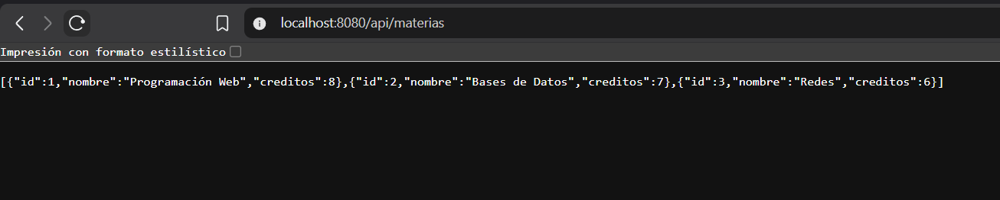
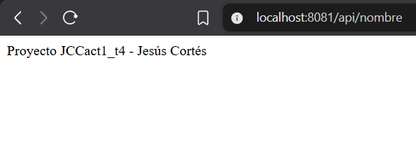
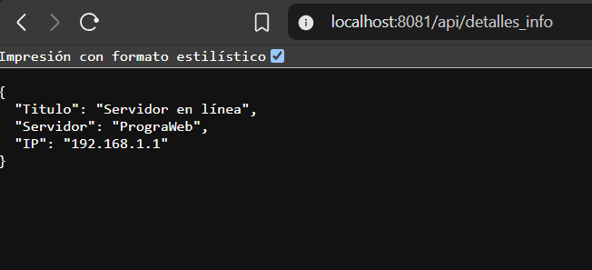
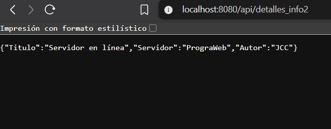
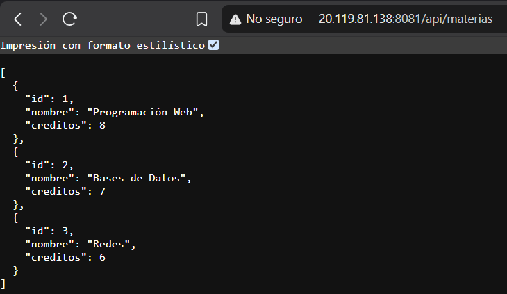
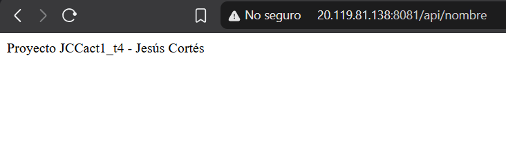
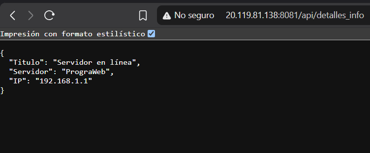
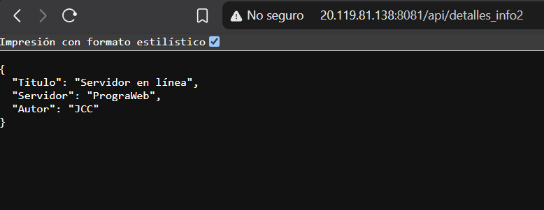

# JCCact1_t4

Instituto Tecnológico de Oaxaca
Materia: Programación Web
Alumno: Jesús Cortés Cruz

## Descripción

Proyecto de Spring Boot que expone una API REST sencilla con dos controladores y cuatro endpoints. Fue probado en local y desplegado en una máquina virtual de Azure.

## Tecnologías

- Java 21
- Spring Boot
- Maven
- Nginx 

## Estructura

- EjemploController: devuelve la lista de materias y un objeto con información del servidor.
- EjemploRestController: devuelve el nombre del proyecto y un objeto con detalles del autor.

## Endpoints

Todos usan el método GET y la ruta base /api.

- /api/materias: lista de materias en formato JSON.
- /api/detalles_info: información del servidor en JSON.
- /api/nombre: texto con el nombre del proyecto y del autor.
- /api/detalles_info2: detalles del autor en JSON.

## Cómo generar el jar

    ./mvnw clean package -DskipTests

El archivo queda en la carpeta target.
## Cuestionario

a) ¿Qué es un @Controller o @RestController y qué diferencia hay?

@Controller es la anotación que marca una clase como controlador web: recibe peticiones HTTP y normalmente devuelve el nombre de una vista (por ejemplo una plantilla HTML). @RestController es la combinación de @Controller y @ResponseBody, por lo que lo que devuelven sus métodos se escribe directamente en la respuesta HTTP, normalmente como JSON o texto. La diferencia es que @Controller se usa para páginas con vistas y @RestController para APIs que devuelven datos. En este proyecto se usó @RestController porque los endpoints devuelven datos.

b) ¿Qué anotación mapea una petición GET y cómo se indica la ruta?

Se usa @GetMapping, indicando la ruta entre paréntesis, por ejemplo @GetMapping("/materias"). Si la clase tiene @RequestMapping("/api"), la ruta completa del endpoint es /api/materias.

c) ¿Qué puerto se usó en el VPS y por qué se definió manualmente?

Se usó el puerto 8081, definido en el archivo application.properties con la línea server.port=8081. Spring Boot usa por defecto el puerto 8080, pero en el VPS compartido cada integrante del equipo debe usar un puerto distinto para que las aplicaciones no choquen, ya que dos programas no pueden escuchar en el mismo puerto. Por eso se definió manualmente y se abrió en el grupo de seguridad de red de Azure.

d) Enlaces

Repositorio de GitHub: https://github.com/JesusCortes-designer/JCCact1_t4

Proyecto en el VPS:     http://20.119.81.138:8081/

## Despliegue

La aplicación corre en una máquina virtual de Azure como servicio de systemd, con Java 21. El puerto usado es el 8080, que se abrió en el grupo de seguridad de red de Azure.

Enlace del proyecto en el servidor:

Enlace del proyecto en el servidor:

    http://20.119.81.138:8081/

    ## Pruebas en localhost

Se ejecutó el proyecto en la máquina local con el comando:

    .\mvnw.cmd spring-boot:run

Y se probaron los endpoints desde el navegador.

Endpoint /api/materias

Endpoint /api/nombre

Endpoint /api/detalles_info

Endpoint /api/detalles_info2

## Pruebas en el VPS

El proyecto está desplegado en una máquina virtual de Azure y corre en el puerto 8081. Se probaron los endpoints desde el navegador usando la IP pública del servidor.

Endpoint /api/nombre (http://20.119.81.138:8081/api/nombre)

Endpoint /api/detalles_info (http://20.119.81.138:8081/api/detalles_info)

Endpoint /api/detalles_info2 (http://20.119.81.138:8081/api/detalles_info2)

## Alumno

Jesús Cortés Cruz
Instituto Tecnológico de Oaxaca
Programación Web